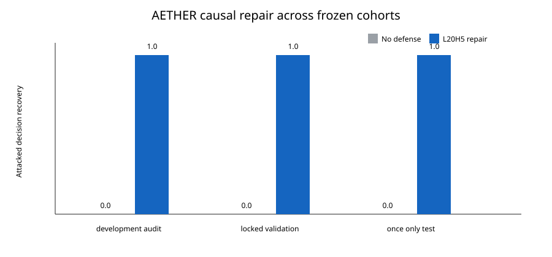

# AETHER

### Distributed Causal Localization in MCP/A2A Multi-Agent Systems

AETHER is a research framework for investigating how an adversarial change propagates through a multi-agent system: from a sender's computation, through a structured message, to a receiver's decision. It combines instrumented model execution, controlled causal interventions, constrained circuit search, and mechanism-guided repair evaluation.

This repository is the **source-and-evidence submission**. It contains implementation, tests, frozen configurations, execution notebooks, and retained experimental artifacts. The presentation demo, temporary downloads, model weights, credentials, internal team instructions, and development logs are excluded.

**Start here:** [Architecture](#architecture) · [Run locally](#run-locally) · [Walkthrough](#presentation-walkthrough) · [Results](#experimental-results) · [Repository map](#repository-map)

## Research question

When an agent follows corrupted information from another agent or tool, which message components and internal model components causally influence the final decision? Can an intervention selected using that evidence recover the intended decision?

Observing an activation difference is not sufficient. AETHER intervenes on specified components and compares the resulting outputs against clean, attacked, identity, and donor controls. Candidate graph topology describes what may be tested; it does not establish causal support by itself.

## Architecture

```mermaid
flowchart LR
    D[Case registry and frozen splits] --> T[Tool evidence / MCP]
    T --> A[Sender Agent A]
    A --> M[Serialized A2A message]
    M --> B[Receiver Agent B]
    B --> O[Decision and raw outputs]
    X[Controlled attack] --> T
    X --> M
    A -. activation capture .-> I[Instrumentation]
    B -. activation capture .-> I
    I --> G[Candidate graph]
    G --> C[Causal intervention evaluator]
    C --> S[Greedy / beam / random / PPO search]
    S --> R[Mechanism-guided repair]
    R --> V[Locked validation and once-only test]
    O --> E[Manifests and evidence verification]
    V --> E
    E --> P[Statistics and report]
```



The diagram describes implemented subsystems. It does not assert that every edge is experimentally supported or that every optional execution backend has a successful result.

### Main components

| Component | Responsibility | Implementation |
|---|---|---|
| Target agents and protocol | Agent execution, structured messages, tool calls and MCP transport | [`target/`](target/), [`contracts/`](contracts/) |
| Attack harness | Controlled tool/message modifications, corpus provenance, orchestration and evaluation | [`attacks/`](attacks/) |
| Paired traces | Aligned clean/attacked cases, behavioral qualification and split controls | [`paired_trace/`](paired_trace/) |
| Model instrumentation | Activation hooks, model adapters and pre-output-projection attention-head access | [`instrumentation/`](instrumentation/) |
| Causal graph and interventions | Candidate construction, legal masks, causal measurements and evidence guards | [`causal/`](causal/) |
| Search | Greedy, beam, random and RL search under explicit budgets | [`discovery/`](discovery/) |
| Repair | Mechanism-selected and comparator interventions | [`remediation/`](remediation/) |
| Experiment execution | Frozen campaigns, checkpointing, manifests and resumable execution | [`experiments/`](experiments/) |
| Evaluation | Statistics, benchmark adapters, verification and reporting | [`evaluation/`](evaluation/), [`benchmarks/`](benchmarks/) |

### Reinforcement learning

RL formulates intervention search as a constrained sequential decision problem. The environment tracks the candidate structure, intervention measurements and remaining query budget. Actions select or remove components and terminate search; rewards reflect the configured causal objective and constraints. Flat PPO is an evaluated comparator. Graph-aware hierarchical search is also implemented and tested on synthetic acceptance tasks; it must not be presented as a successful real-model improvement without corresponding evidence.

The contribution being investigated is the cross-boundary causal formulation and intervention/search system, not the invention of PPO, MCP, or activation patching.

## Experimental results

The central retained experiment uses **Qwen2.5-1.5B-Instruct**, pinned to revision `989aa7980e4cf806f80c7fef2b1adb7bc71aa306`, on a frozen, balanced, synthetic decision-code task.

| Study | Retained outcome | Interpretation |
|---|---|---|
| CORE-02 matched search | All distributed-capable methods selected `message.decision_code`; the receiver-only comparator selected L20H5 | A decision-code message bottleneck was sufficient under this task; this is not evidence of a complete distributed internal circuit |
| CORE-03 development repair | The frozen selection rule chose the receiver L20H5 repair | Development selection, not held-out evaluation |
| CORE-04 locked validation | Repair recovered attacked decisions on 8/8 cases; clean accuracy was 8/8 | Internal validation under the frozen paired-clean-donor protocol |
| CORE-05 once-only test | Repair recovered attacked decisions on 8/8 cases; clean accuracy was 8/8 | Internal held-out test under the same protocol; no test tuning |
| Trained SAE | Retained training completed without an eligible checkpoint | Negative eligibility result, not validated sparse causal features |
| SmolLM2 | Behavioral qualification failed | No supported cross-model generalization claim |
| Agent C | Completed development evaluation without an improvement | Execution integrity is distinct from defense effectiveness |
| Official BFCL / MCPTox / TAMAS | Required successful official evidence remains incomplete | Adapters and runners are not benchmark scores |
| Real-Qwen red team | Retained attempt rejected because of inference errors | Not an accepted attack-success estimate |

The validation and test cohorts each contain eight unique cases. Repeated deterministic seeds are not independent additional subjects. Exact paired McNemar results and intervals are provided by the [causal-core report](results/phase1/causal_core_report/causal_core_report.json).



**Scope of the positive result:** the L20H5 intervention uses a paired clean activation donor—an oracle dependency. These results do not establish a deployable defense, clinical validity, population-level performance, global circuit minimality, or RL superiority. The task may substantially measure decision-code copying. The all-project evidence gate therefore remains incomplete.

### Inspect the evidence

| Stage | Retained artifacts |
|---|---|
| Behavioral qualification | [`results/phase1/model_qualification/`](results/phase1/model_qualification/) |
| Instrumentation acceptance | [`results/phase1/instrumentation_acceptance/`](results/phase1/instrumentation_acceptance/) |
| Causal interventions and controls | [`results/phase1/causal_interventions/`](results/phase1/causal_interventions/) |
| Matched search | [`results/phase1/search_comparison/`](results/phase1/search_comparison/) |
| Development repair | [`results/phase1/remediation/`](results/phase1/remediation/) |
| Locked validation | [`results/phase1/locked_validation/`](results/phase1/locked_validation/) |
| Once-only test | [`results/phase1/once_only_test/`](results/phase1/once_only_test/) |
| Supporting studies | [`results/phase1/sae/`](results/phase1/sae/), [`results/phase1/agent_c/`](results/phase1/agent_c/) |

Result directories retain summaries, manifests and available raw measurements. Some large model/activation artifacts are intentionally external. Original run commits identify the historical development repository, not this submission snapshot. Hash-addressed evidence files are copied without rewriting their contents.

## Run locally

### 1. Create a Python 3.11 environment

The tested local environment uses Python 3.11.9. Do not substitute a notebook's default Python 3.13 environment for the isolated research interpreter.

```powershell
git clone https://github.com/DXVNX/AETHER-Distributed-Causal-Localization-in-MCP-A2A-Multi-Agent-Systems.git
cd AETHER-Distributed-Causal-Localization-in-MCP-A2A-Multi-Agent-Systems
py -3.11 -m venv .venv
.\.venv\Scripts\python.exe -m pip install -r requirements-demo-lock.txt
.\.venv\Scripts\python.exe -m pip install --no-deps -e .
.\.venv\Scripts\python.exe -m pip check
.\.venv\Scripts\python.exe scripts/prepare_submission.py
```

`requirements-demo-lock.txt` retains its historical filename because the existing execution packages reference it. It includes the research lock plus MCP and supporting runtime dependencies; **the demo application is not included**. This is the tested Windows lock. GPU/Linux notebook environments have separate installation cells; do not replace their pinned Torch/CUDA stack with a generic global install.

The preparation command verifies seven reference documents in [`protocols/`](protocols/) and recreates their original, ignored `docs/` paths. Frozen manifests continue to address the original paths and hashes. No scientific parameters or evidence are modified. The README is the only tracked Markdown document.

### 2. Run the model-independent tests

```powershell
.\.venv\Scripts\python.exe -m pytest tests/unit tests/integration tests/regression -ra
.\.venv\Scripts\python.exe scripts/validate_repository.py
```

These checks cover contracts, intervention semantics, budget accounting, checkpoint behavior, artifact integrity, split protection, search and reporting. Synthetic test fixtures validate software behavior; they are not experimental evidence. Tests requiring real model prerequisites remain explicitly skipped unless those prerequisites are supplied.

### 3. Verify retained causal results without running Qwen

```powershell
.\.venv\Scripts\python.exe -m scripts.verify_qci2_matched_search_bundle results/phase1/search_comparison
.\.venv\Scripts\python.exe -m scripts.verify_core03_remediation_bundle results/phase1/remediation
.\.venv\Scripts\python.exe -m scripts.verify_core04_validation_bundle results/phase1/locked_validation
.\.venv\Scripts\python.exe -m scripts.verify_core05_test_bundle results/phase1/once_only_test
.\.venv\Scripts\python.exe -m evaluation.causal_core_report --output outputs/causal-core-report
```

Verification reads retained artifacts; it does not rerun the locked test. Generated reports go to the ignored `outputs/` directory.

### 4. Inspect the remaining evidence gates

```powershell
.\.venv\Scripts\python.exe -m scripts.audit_phase1_completion
```

This command deliberately returns a nonzero exit status while required evidence is missing. Do not suppress it or interpret implementation readiness as experimental completion.

## Presentation walkthrough

1. **Explain the problem:** a sender communicates evidence to a receiver; corrupted evidence can change the receiver's decision.
2. **Show the contracts:** open [`contracts/`](contracts/) and [`paired_trace/schemas.py`](paired_trace/schemas.py) to explain message structure and reproducible serialization.
3. **Show the controls:** use [`configs/`](configs/) and [`data/`](data/) to explain fixed cases, clean/attacked pairs, development/validation/test separation and frozen thresholds.
4. **Explain intervention rather than correlation:** show [`instrumentation/`](instrumentation/) and [`causal/`](causal/), including head access, donor activations, legal masks and independently supported edges.
5. **Compare search methods:** inspect the CORE-02 summary and budgets. Explain that PPO did not outperform the simpler methods in the retained experiment.
6. **Show the successful measured repair:** inspect CORE-03 through CORE-05 and the generated report. State the eight-case denominator and paired-clean-donor limitation explicitly.
7. **Demonstrate reproducibility:** run the retained-artifact verifiers and explain manifests, hashes, raw outputs and fail-closed checks.
8. **Close with limitations:** distinguish completed negative supporting studies from missing official benchmark evidence.

## Repository map

```text
attacks/           Attack corpus, transformations and orchestration
benchmarks/        Official benchmark interfaces and execution checks
calibration/       Calibration utilities
causal/            Causal graph, intervention and evidence logic
configs/           Frozen protocols, models, budgets and execution plans
contracts/         Shared data contracts
data/              Tracked case registries, controls and manifests
discovery/         Greedy, beam, random and RL search
evaluation/        Metrics, statistical analysis and report generation
experiments/       Experiment runners and provenance manifests
instrumentation/   Model adapters and activation hooks
notebooks/         Output-cleared historical execution notebooks
paired_trace/      Paired task construction and model qualification
protocols/         Hash-verified scientific references in plain text
remediation/       Repair implementations
results/           Retained research evidence, including negative outcomes
scripts/           Preparation, verification, ingestion and utilities
target/            Agent, tool and MCP implementation
tests/             Unit, integration and regression verification
```

Source package names are preserved to avoid breaking imports, frozen paths and verifier contracts. [`submission_manifest.json`](submission_manifest.json) records the originating commit, export exclusions and retained evidence hashes.

## Notebooks and external execution

The notebooks are historical execution packages, not a recommendation to run every notebook sequentially. Their immutable source pins intentionally refer to the original development history; this snapshot does not rewrite those pins or pretend to contain that history. Notebook outputs are cleared to avoid publishing session data and duplicating result bundles.

CORE-05 is a completed once-only test and **must not be rerun as another evaluation attempt**. Study the retained outputs and run the verifier instead. New evidence-bearing campaigns require compatible hardware, the declared immutable model/data revisions, and the applicable frozen protocol. Tokens belong in private notebook secrets, never in committed cells.

## Data and attribution

- The central Qwen causal evidence uses the project's **synthetic balanced decision-code substrate**. It is not a clinical dataset result.
- PTB-XL integration provides standardized case-provenance infrastructure. PTB-XL is published through [PhysioNet](https://physionet.org/content/ptb-xl/1.0.3/) under CC BY 4.0; its waveform data are not distributed here. The removed presentation demo is not an official PTB-XL benchmark.
- WikiText is the declared external corpus for the retained SAE training protocol. Exact revisions and source hashes are recorded in the frozen configurations and retained artifacts.
- BFCL, MCPTox, TAMAS, AgentDojo and other upstream projects retain their own licenses and attribution requirements. Integration code or proposed configurations do not establish a successful official run.
- Model weights and restricted datasets are not included. No new blanket license is asserted for third-party assets or the project code by this submission export.

## Reproducibility principles

Experiments record source revision, model/tokenizer revision, configuration and dataset hashes, seeds, raw outputs and execution metadata. Locked splits are protected, invalid/error outcomes remain visible, and verifiers reject incomplete or altered evidence. Negative results are retained alongside successful results. The purpose of this repository is to make the implemented work and its actual empirical scope inspectable.
